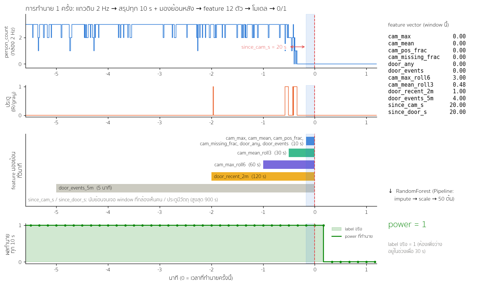
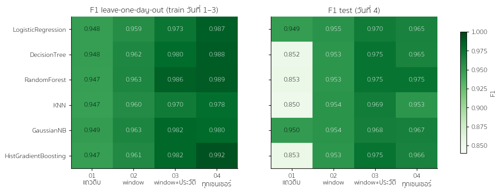
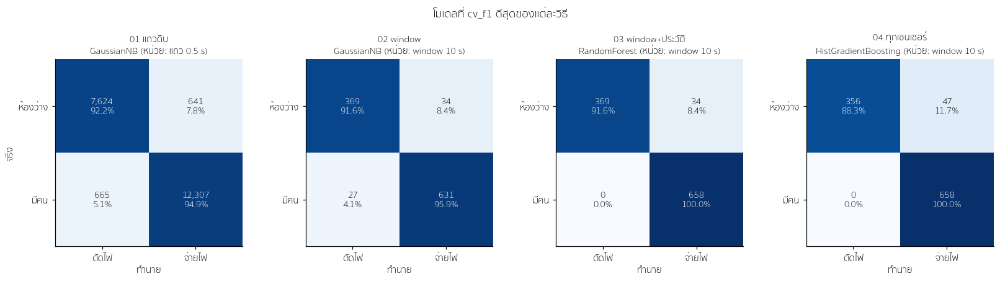
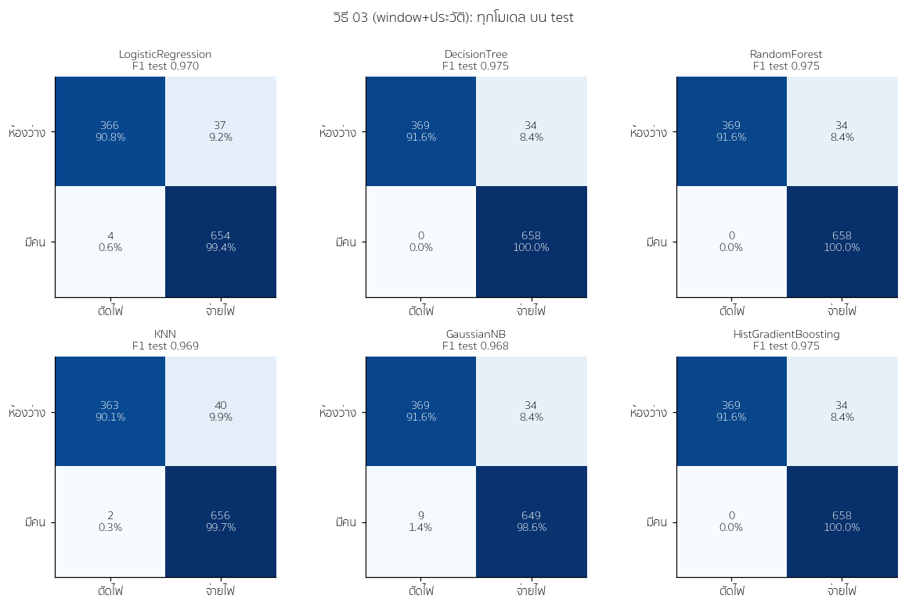

# ML report: ทำนาย `power_on`

> ข้อมูลเป็น**ข้อมูลจำลอง (synthetic)** ตัวเลขและรูปทั้งหมดมาจากการรัน notebook ในโฟลเดอร์นี้ (รูปจาก `05_compare.ipynb`)

## สรุป

- feature ที่ดีที่สุดคือ **window 10 s + ประวัติย้อนหลัง** (`03_window_history.ipynb`) โมเดลทุกตัวได้ F1 ≥ 0.968 บน test
- โมเดลที่ deploy คือ **RandomForest** (50 ต้น, ลึก 6) ได้ F1 leave-one-day-out 0.986 และบน test (วันที่ 4) ได้ F1 0.975 recall 1.000 คือไม่เคยตัดไฟขณะมีคน ผิดเฉพาะไฟเปิดทิ้ง 34 window (5.7 นาที)
- อุณหภูมิ ความชื้น MQ-2 และ LDR (`04`) เพิ่ม F1 ของ CV แต่ไม่ช่วยบน test และ LDR เป็น leakage จึงไม่ใช้

## ปัญหาและข้อมูล

| หัวข้อ | ค่า |
| --- | --- |
| งาน | binary classification: `power_on` 1 = ควรจ่ายไฟ (มีคน หรือคนเพิ่งออกไม่เกิน 30 s) |
| train / test | วันที่ 1–3 / วันที่ 4 (แบ่งตามวัน วันที่ 4 มีแดดซึ่งไม่มีใน train) |
| Pipeline | `SimpleImputer(median) → StandardScaler → classifier` เหมือนกันทุกโมเดล |
| เลือกโมเดล | leave-one-day-out F1 บน train (`cv_f1`): เทรน 2 วัน ทดสอบวันที่เหลือ วน 3 รอบ ส่วน test ดูครั้งเดียว ไม่ใช้เลือก |
| โมเดลที่เทียบ | LogisticRegression, DecisionTree (depth 3), RandomForest (50 ต้น, depth 6), KNN (k = 15), GaussianNB, HistGradientBoosting (depth 4) |

## การ preprocess และ feature

### ขั้นที่ทุกวิธีทำเหมือนกัน

| ขั้น | ทำอะไร | เหตุผล |
| --- | --- | --- |
| ตัด warm-up | ทิ้ง 3 นาทีแรกของ session (360 แถว / 18 window) เฉพาะ `boot = 0` | MQ-2 ยังไม่นิ่ง และห้องว่างตาม protocol ทุกวัน (ทายง่ายเกินจริง) หลังบอร์ดรีเซ็ตกลาง session ไม่ตัด เพราะมีคนอยู่จริง |
| แยกตาม `(day, boot)` | คำนวณ window และ rolling แยกแต่ละช่วงบูต | `timestamp_ms` เริ่มนับใหม่ตอนรีเซ็ต feature ย้อนหลังห้ามข้ามช่วง |
| `person_count = -1` → NaN | กล้องไม่ส่งข้อมูล ไม่ใช่ "0 คน" | ถ้าปล่อยเป็น -1 โมเดลจะเข้าใจว่าเป็นตัวเลขจริง |
| `SimpleImputer(median)` | เติม NaN ด้วย median ของ train | อยู่ใน Pipeline จึงเรียนจาก fold ที่เทรนเท่านั้น |
| `StandardScaler` | ทำให้ทุก feature มี mean 0, sd 1 | จำเป็นกับ LogReg / KNN ส่วนโมเดลต้นไม้ไม่มีผล ใส่ไว้ให้ Pipeline เหมือนกันทุกตัว |
| สัญญาณประตู `door` | `door = (digital_do == 0) OR (analog_2_raw > 1000)` | IR (active-low) หรือ gray sensor ที่ธรณีเห็นวัตถุผ่านประตู |

### 01 · แถวดิบ (2 Hz, 3 feature)

ทำนายทุกแถวจากค่า ณ ขณะนั้นเท่านั้น: `person_count`, `digital_do`, `analog_2_raw` · label = `power_on` ของแถว เป็น baseline ที่ไม่มีความจำ

### 02 · สรุปทุก window 10 s (6 feature)

รวมทีละ 20 แถว (นับตามลำดับแถวเหมือนบอร์ดนับ sample) ทิ้ง window สุดท้ายที่ไม่ครบ 20 แถว · label = `max(power_on)` ใน window (มีวินาทีใดควรจ่ายไฟ ทั้ง window = 1)

| feature | สูตร (ใน window) | จับอะไร |
| --- | --- | --- |
| `cam_max` | max ของ `person_count` | จำนวนคนสูงสุด ทนต่อการนับขาดชั่วขณะ |
| `cam_mean` | mean ของ `person_count` | ระดับคนเฉลี่ย |
| `cam_pos_frac` | สัดส่วนแถวที่กล้องเห็น ≥ 1 คน (เฉพาะแถวที่มีข้อมูล) | ความต่อเนื่องของการเห็นคน |
| `cam_missing_frac` | สัดส่วนแถวที่กล้องไม่ส่ง | บอกโมเดลว่าค่ากล้องเชื่อได้แค่ไหน |
| `door_any` | มี `door = 1` อย่างน้อย 1 แถว | มีการเข้า-ออกใน 10 s นี้ |
| `door_events` | จำนวนขอบขาขึ้นของ `door` | จำนวนครั้งที่มีวัตถุผ่านประตู |

### 03 · window + ประวัติย้อนหลัง (12 feature) ← ใช้ deploy

02 + 6 feature ที่มองย้อนหลังหลาย window (ใช้แค่อดีต จึงคำนวณ real-time บนบอร์ดได้)

| feature | สูตร | มองย้อน | จับอะไร |
| --- | --- | --- | --- |
| `cam_mean_roll3` | mean ของ `cam_mean` 3 window ล่าสุด | 30 s | ลด noise ของกล้อง |
| `cam_max_roll6` | max ของ `cam_max` (NaN = 0) 6 window ล่าสุด | 1 นาที | คนที่ถูกบังหรืออยู่มุมอับชั่วคราว |
| `door_recent_2m` | max ของ `door_any` 12 window ล่าสุด | 2 นาที | เพิ่งมีคนเข้า-ออก |
| `door_events_5m` | ผลรวม `door_events` 30 window ล่าสุด | 5 นาที | ความถี่การเข้า-ออก |
| `since_cam_s` | วินาทีนับจาก window ล่าสุดที่ `cam_max > 0` (เพดาน 900, ไม่เคยเห็น = 900) | ไม่จำกัด | **ตัวสำคัญที่สุด** ตรงกับนิยาม label (เผื่อ 30 s หลังคนออก) |
| `since_door_s` | วินาทีนับจาก window ล่าสุดที่ `door_any = 1` (เพดาน 900) | ไม่จำกัด | ห้องนิ่งมานานแค่ไหน |

### 04 · ทุกเซนเซอร์ (17 feature)

03 + `temp` (mean `temp_c`), `hum` (mean `humidity`), `mq2` (median `mq2_raw`), `temp_slope_5m` (อุณหภูมิเปลี่ยนต่อนาทีใน 5 นาที), `ldr` (mean `analog_1_raw`) — ใส่เพื่อทดสอบว่าช่วยไหม ไม่ได้ตั้งใจใช้ deploy

### การ feed feature ให้การทำนาย 1 ครั้ง



ตัวอย่างจริงจาก test วันที่ 4 ตอนห้องเพิ่งว่าง (เส้นประแดง = เวลาที่ทำนาย, แถบฟ้า = window ปัจจุบัน 10 s)

1. แถวบน 2 แถว: ข้อมูลดิบที่บอร์ดได้ทุก 0.5 s (จำนวนคนจากกล้อง และสัญญาณประตู)
2. แถวที่ 3: feature แต่ละกลุ่มมองย้อนหลังยาวไม่เท่ากัน ตั้งแต่ 10 s (window ปัจจุบัน) ถึง 5 นาที ส่วน `since_cam_s` นับย้อนจนเจอ window ที่กล้องเห็นคน (ลูกศรแดง = 20 s)
3. ขวา: feature 12 ตัวที่ได้ → RandomForest → `power = 1` แม้กล้องจะเห็น 0 คนแล้ว เพราะ `since_cam_s = 20` ยังไม่เกินช่วงเผื่อ ตรงกับ label
4. แถวล่าง: ทำซ้ำทุก 10 s ได้ผลทำนาย 1 ค่าต่อ window ไฟตัดหลังจากนั้น 1 window พร้อมกับ label

## ผล



| โมเดล | 01 cv / test | 02 cv / test | 03 cv / test | 04 cv / test |
| --- | --- | --- | --- | --- |
| LogisticRegression | 0.948 / 0.949 | 0.959 / 0.955 | 0.973 / 0.970 | 0.987 / 0.965 |
| DecisionTree (depth 3) | 0.948 / 0.852 | 0.962 / 0.953 | 0.980 / 0.975 | 0.988 / 0.965 |
| RandomForest (50, depth 6) | 0.947 / 0.853 | 0.963 / 0.953 | **0.986 / 0.975** | 0.989 / 0.975 |
| KNN (k=15) | 0.947 / 0.850 | 0.960 / 0.954 | 0.970 / 0.969 | 0.978 / 0.953 |
| GaussianNB | 0.949 / 0.950 | 0.963 / 0.954 | 0.982 / 0.968 | 0.980 / 0.967 |
| HistGradientBoosting | 0.947 / 0.853 | 0.961 / 0.953 | 0.982 / 0.975 | 0.992 / 0.966 |

### Confusion matrix (test วันที่ 4)

แถว = ความจริง, คอลัมน์ = ที่ทำนาย · ช่องซ้ายล่าง = **ตัดไฟใส่คน (FN)** แย่ที่สุด · ช่องขวาบน = **ไฟเปิดทิ้ง (FP)** เปลืองไฟ
("มีคน" = label 1 ซึ่งรวมช่วงเผื่อ 30 s หลังคนออก)



โมเดลที่ `cv_f1` ดีสุดของแต่ละวิธี (01 นับเป็นแถว 0.5 s ส่วน 02–04 นับเป็น window 10 s จึงเทียบด้วย % ในแต่ละแถว)

| วิธี | โมเดล | FN ตัดไฟใส่คน | FP ไฟเปิดทิ้ง |
| --- | --- | --- | --- |
| 01 | GaussianNB | 665 แถว (5.1%) | 641 แถว (7.8%) |
| 02 | GaussianNB | 27 window (4.1%) | 34 window (8.4%) |
| 03 | RandomForest | **0** | 34 window (8.4%) |
| 04 | HistGradientBoosting | 0 | 47 window (11.7%) |



ในวิธี 03 โมเดลต้นไม้ทั้ง 3 ตัว (DT, RF, HGB) ได้ผลบน test เหมือนกันทุกช่อง: FN 0, FP 34 ส่วน LogReg (FN 4), KNN (FN 2) และ GaussianNB (FN 9) ยังตัดไฟใส่คนบางครั้ง

### ข้อสังเกต

- **01 → 02 → 03 ดีขึ้นทุกขั้น** ประวัติย้อนหลังทำให้ FN หายหมด เพราะ label มีช่วงเผื่อ 30 s หลังคนสุดท้ายออก ซึ่งค่าชั่วขณะมองไม่เห็น แต่ `since_cam_s` เห็น
- **01 กับโมเดลต้นไม้ ได้ test ต่ำ (0.85)** precision ตกเหลือ 0.75 แถวเดี่ยวไม่มีข้อมูลพอ และโมเดลซับซ้อนจำรูปแบบเฉพาะของ train
- **04 ได้ CV สูงสุด แต่ test ไม่ดีกว่า 03 และ FP มากขึ้น** ห้องจำลองใช้ตุ๊กตาซึ่งไม่ปล่อยความร้อน อุณหภูมิจึงเปลี่ยนตามแอร์และเวลาของวัน (confounder) ส่วน LDR สะท้อนไฟ LED ที่ผู้ทดลองเปิดตามจำนวนคน ซึ่งคือ label ที่รั่ว (leakage) และใช้ไม่ได้เมื่อระบบเป็นคนสั่งไฟเอง
- FP 34 window ของ RandomForest ใน 03: **33 window อยู่ช่วงลืมคีมไว้ในกล่อง** (12:03–12:12 วันที่ 4 กล้องนับคีมเป็นคน ห้องว่างจริง) ซึ่ง feature จากกล้องแก้ไม่ได้ อีก 1 window คือ 11:42:20

## โมเดลที่ deploy

ใน `../predictor_class/export_model.ipynb` เลือกเฉพาะโมเดลที่ export เป็น C array ได้ บน feature ชุด 03:

| โมเดล | cv_f1 |
| --- | --- |
| DecisionTree | 0.980 |
| LogisticRegression | 0.973 |
| **RandomForest** | **0.986** ← เลือก (กติกา: สูงสุด ถ้าต่างกัน ≤ 0.002 เลือกตัวง่ายกว่า) |

- weight อยู่ที่ `model.joblib` และ `RoomSensePredictor/model_weights.h` (source 62 KB, เป็น `const` อยู่ใน flash)
- ตรวจแล้ว: `RoomSensePredictor.h` คอมไพล์ด้วย g++ ป้อนแถวดิบทีละแถว ได้ผลตรงกับ Python **3,182/3,182** window (train) และ **1,061/1,061** (test)
- ถ้าบอร์ดหน่วยความจำไม่พอ DecisionTree ได้ confusion matrix บน test เท่ากันทุกช่อง แต่ CV ต่ำกว่า 0.006 ให้เปลี่ยน `cands` ใน notebook

## ข้อจำกัด

- ข้อมูลจำลอง ต้องยืนยันด้วยข้อมูลจริง
- test มีแค่ 1 วัน
- ยังไม่ได้วัดเวลาและหน่วยความจำบน ESP32 จริง (ตรวจแค่ด้วย g++ บนเครื่อง)
- alarm ไฟไหม้ไม่อยู่ในโมเดล ต้องเป็น hard rule แยก: `relay = power && !alarm`

## รันซ้ำ

```bash
cd src/ml_pipeline && jupyter nbconvert --to notebook --execute --inplace 0*.ipynb   # 05_compare รัน 01–04 ให้เองด้วย
cd ../predictor_class && jupyter nbconvert --to notebook --execute --inplace export_model.ipynb
```
ต้องใช้ numpy, pandas, scikit-learn, matplotlib, joblib, ฟอนต์ Sukhumvit Set (macOS) สำหรับภาษาไทยในรูป และ g++ (สำหรับเช็ก C++)
