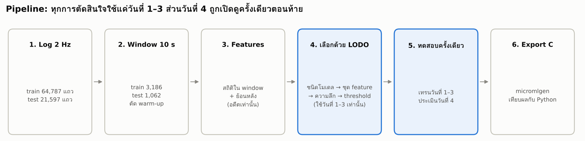
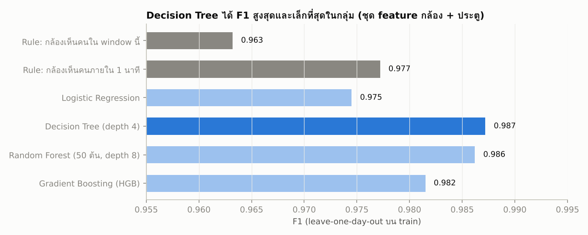
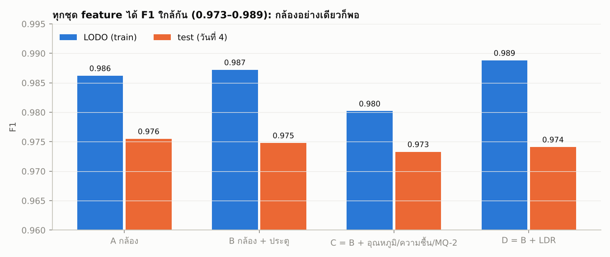
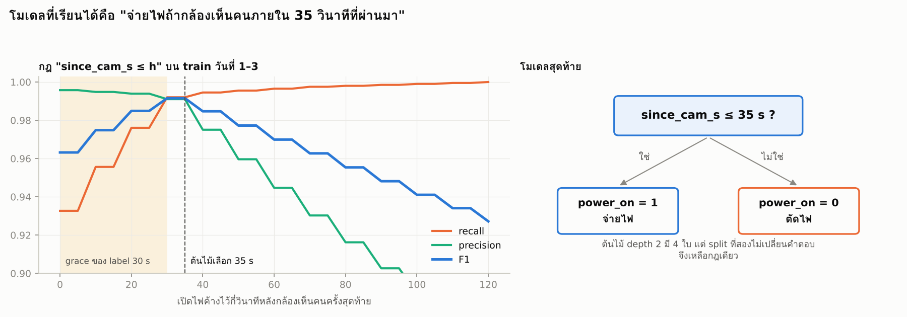
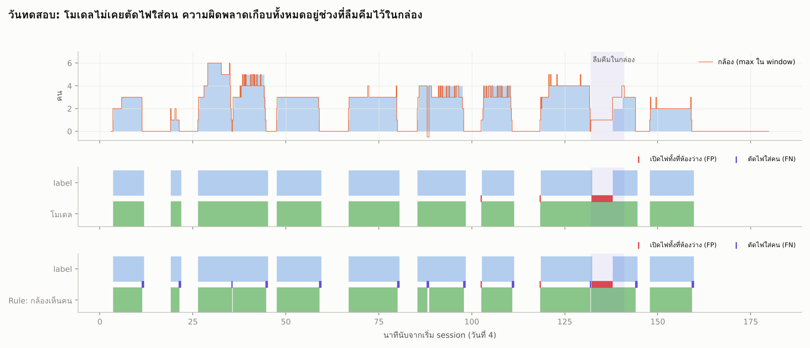
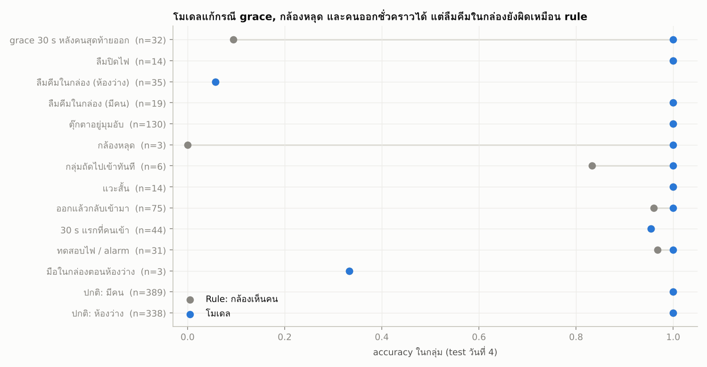

# รายงาน Machine Learning: ทำนายการจ่ายไฟห้องประชุมจำลอง

> ข้อมูลที่ใช้เป็น**ข้อมูลจำลอง (synthetic)** จากรายงานการทดลองฉบับก่อน ผลในรายงานนี้แสดงวิธีวิเคราะห์ และต้องยืนยันด้วยข้อมูลจริงอีกครั้ง
> ตัวเลขทุกตัวคำนวณจากโค้ดในโฟลเดอร์ `ml/` (`run_ml.py`, `export_c.py`)

## บทสรุป

โมเดลที่เลือกได้คือ Decision Tree ลึก 2 ชั้น ซึ่งลดรูปเหลือกฎข้อเดียว: **จ่ายไฟถ้ากล้องเห็นคนภายใน 35 วินาทีที่ผ่านมา**
ในวันทดสอบ (วันที่ 4) ได้ F1 0.974, recall 1.000 คือไม่เคยตัดไฟใส่คนเลย และ precision 0.950
ข้อผิดพลาดทั้งหมด 35 window (ไฟเปิดทิ้ง 5.8 นาที) และ 33 window ในนั้นเกิดช่วงที่ลืมคีมไว้ในกล่องขณะห้องว่าง ซึ่งเป็นกรณีที่ไม่มีใน train
เซนเซอร์ประตู อุณหภูมิ ความชื้น MQ-2 และ LDR ไม่ช่วยเพิ่มความแม่นยำ โมเดลมีขนาด 996 bytes เมื่อเป็นโค้ด C และให้ผลตรงกับ Python ครบ 1,062/1,062 window

## 1. นิยามปัญหา

| หัวข้อ | ค่า |
| --- | --- |
| งาน | Binary classification: `power_on` = 1 (จ่ายไฟ) หรือ 0 (ตัดไฟ) |
| หน่วยการทำนาย | 1 window = 10 วินาที (20 แถวของ log 2 Hz) ทำนายทุก 10 วินาที |
| Input | feature จาก window ปัจจุบันและ window ก่อนหน้า (ห้ามใช้ข้อมูลอนาคต) |
| ข้อจำกัด | ต้องรันบน ESP32 ได้: โมเดลเล็ก คำนวณ feature ด้วย buffer ย้อนหลังไม่เกิน 5 นาที |
| ความผิดพลาดที่แย่ที่สุด | ตัดไฟขณะมีคน (FN) จึงตั้งเป้า recall ≥ 0.99 ก่อน แล้วค่อยลดไฟเปิดทิ้ง (FP) |
| ความปลอดภัย | ไม่อยู่ในโมเดล ใช้ `alarm` เป็น hard rule แยกต่างหาก (หัวข้อ 11) |

## 2. ข้อมูลและการเตรียมข้อมูล

| ขั้น | รายละเอียด |
| --- | --- |
| แหล่งข้อมูล | `train.csv` (วันที่ 1–3, 64,787 แถว) และ `test.csv` (วันที่ 4, 21,597 แถว) |
| Sentinel | `person_count = -1` เป็น NaN, `temp_c`/`humidity` = `nan` คงเป็น NaN |
| แบ่ง window | ใช้เวลาใน session แบ่งเป็นช่วง 10 วินาที แยกตาม `day` และ `boot` (feature ย้อนหลังไม่ข้ามการรีเซ็ตของบอร์ด) |
| Warm-up | ตัด 3 นาทีแรกของแต่ละ session (MQ-2 ยังไม่นิ่ง และห้องว่างตาม protocol) |
| label ของ window | `max(power_on)` ใน window: ถ้ามีวินาทีใดควรจ่ายไฟ ทั้ง window เป็น 1 |
| จำนวน window | train 3,186 (วันที่ 1: 1,032, วันที่ 2: 1,092, วันที่ 3: 1,062), test 1,062 |
| สัดส่วน label = 1 | train 0.630, test 0.620 |

## 3. Feature

ทุก feature คำนวณจาก window ปัจจุบันและอดีตเท่านั้น จึงคำนวณบน ESP32 ได้แบบ real-time

| feature | กลุ่ม | ความหมาย |
| --- | --- | --- |
| `cam_max` | กล้อง | จำนวนคนสูงสุดใน window |
| `cam_mean` | กล้อง | จำนวนคนเฉลี่ยใน window |
| `cam_pos_frac` | กล้อง | สัดส่วนแถวที่กล้องเห็น ≥ 1 คน |
| `cam_missing_frac` | กล้อง | สัดส่วนแถวที่กล้องไม่ส่งข้อมูล (`-1`) |
| `cam_max_roll6` | กล้อง | `cam_max` สูงสุดใน 6 window ล่าสุด (1 นาที) |
| `cam_mean_roll3` | กล้อง | `cam_mean` เฉลี่ย 3 window ล่าสุด (30 s) |
| `since_cam_s` | กล้อง | วินาทีนับจาก window ล่าสุดที่กล้องเห็น ≥ 1 คน (เพดาน 900) |
| `door_any` | ประตู | IR = 0 หรือ gray > 1,000 ใน window นี้ |
| `door_events` | ประตู | จำนวนครั้งที่ประตูเริ่มมีวัตถุผ่าน |
| `door_recent_2m` | ประตู | มีกิจกรรมที่ประตูใน 2 นาทีที่ผ่านมา |
| `door_events_5m` | ประตู | จำนวนครั้งที่มีวัตถุผ่านประตูใน 5 นาที |
| `since_door_s` | ประตู | วินาทีนับจากกิจกรรมที่ประตูครั้งล่าสุด |
| `temp, hum, mq2` | สภาพแวดล้อม | ค่าเฉลี่ย/median ใน window |
| `temp_slope_5m` | สภาพแวดล้อม | อุณหภูมิเปลี่ยนต่อนาที ในรอบ 5 นาที |
| `ldr_mean` | LDR | ค่าเฉลี่ย `analog_1_raw` (ใช้เฉพาะทดสอบ leakage) |

ตัด `temp_f` และ heat index ออก เพราะคำนวณมาจากอุณหภูมิและความชื้นโดยตรง ส่วน LDR ใช้เฉพาะเพื่อวัดผลของ leakage เพราะค่าสะท้อนสถานะ LED ที่ผู้ทดลองเปิดตาม label

## 4. การออกแบบ validation



- **Test set** คือวันที่ 4 ทั้งวัน ใช้ประเมินครั้งเดียวหลังตัดสินใจทุกอย่างแล้ว
- **การตัดสินใจทุกอย่าง** (ชนิดโมเดล, ชุด feature, ความลึก, threshold) ใช้ **leave-one-day-out (LODO)** บน train: เทรน 2 วัน ทดสอบวันที่เหลือ วน 3 รอบ แล้วรวมผล
- **ไม่สุ่มแบ่งแถว** เพราะ window ที่ติดกันมีค่าเกือบเหมือนกัน (ACF ของจำนวนคนจากกล้องที่ระยะ 10 วินาทีเท่ากับ 0.93) การสุ่มจะทำให้ผลดีเกินจริง
- **กติกาเลือก**: เลือกตัวที่ F1 ของ LODO สูงสุด ถ้ามีหลายตัวต่างกันไม่เกิน 0.002 ให้เลือกตัวที่เล็กหรือง่ายที่สุด เพราะต้องรันบน ESP32

## 5. Baseline และการเปรียบเทียบโมเดล

เทียบบนชุด feature กล้อง + ประตู ด้วย LODO บน train (threshold 0.5)



| โมเดล | F1 | recall | precision | FP | FN |
| --- | --- | --- | --- | --- | --- |
| Majority (ทาย 0 เสมอ) | 0.000 | 0.000 | 0.000 | 0 | 2006 |
| Rule: กล้องเห็นคนใน window นี้ | 0.963 | 0.933 | 0.996 | 8 | 135 |
| Rule: กล้องเห็นคนภายใน 1 นาที | 0.977 | 0.996 | 0.960 | 84 | 9 |
| Logistic Regression | 0.975 | 0.962 | 0.987 | 25 | 76 |
| Decision Tree (depth 4) | 0.987 | 0.980 | 0.994 | 11 | 40 |
| Random Forest (50 ต้น, depth 8) | 0.986 | 0.982 | 0.991 | 18 | 37 |
| Gradient Boosting (HGB) | 0.982 | 0.978 | 0.985 | 29 | 45 |

Decision Tree ได้ F1 สูงสุด (0.987) และเล็กที่สุดในกลุ่ม ML จึงถูกเลือก Random Forest ใกล้เคียงแต่ใหญ่กว่าหลายสิบเท่า ส่วน rule "กล้องเห็นคนใน window นี้" ได้ recall ต่ำ เพราะตัดไฟทันทีที่กล้องพลาดไป 1 window

## 6. Ablation: เซนเซอร์กลุ่มไหนช่วย

ใช้ Decision Tree depth 4 เท่ากันทุกชุด



| ชุด feature | จำนวน | F1 LODO | F1 test | recall test | precision test |
| --- | --- | --- | --- | --- | --- |
| A กล้อง | 7 | 0.986 | 0.976 | 1.000 | 0.952 |
| B กล้อง + ประตู | 12 | 0.987 | 0.975 | 0.999 | 0.952 |
| C = B + อุณหภูมิ/ความชื้น/MQ-2 | 16 | 0.980 | 0.973 | 0.999 | 0.949 |
| D = B + LDR | 13 | 0.989 | 0.974 | 1.000 | 0.950 |

- **ประตูไม่ช่วย**: B ได้ F1 LODO สูงกว่า A เพียง 0.001 ซึ่งอยู่ในเกณฑ์ 0.002 จึงเลือก A ที่ใช้ feature น้อยกว่า
- **อุณหภูมิ ความชื้น MQ-2 ทำให้แย่ลง** (C) เพราะในกล่องจำลองค่าเหล่านี้เปลี่ยนตามแอร์และ heater ไม่ใช่ตามคน
- **LDR ได้ F1 LODO สูงสุด** (D) แต่ตัดออกตั้งแต่ต้น เพราะเป็น leakage: ระบบจริงที่โมเดลเป็นคนสั่งเปิดไฟ ค่า LDR จะสะท้อนการตัดสินใจของโมเดลเอง ไม่ใช่การมีคน
- ชุด C และ D ถูกตัดออกตั้งแต่ขั้น EDA และแสดงไว้เพื่อยืนยันเท่านั้น ไม่ได้ใช้ในการเลือก

## 7. โมเดลสุดท้าย

ความลึกของต้นไม้บนชุด A (LODO):

| max_depth | F1 | recall | precision |
| --- | --- | --- | --- |
| 2 | 0.992 | 0.992 | 0.991 |
| 3 | 0.986 | 0.981 | 0.991 |
| 4 | 0.986 | 0.981 | 0.992 |
| 5 | 0.986 | 0.981 | 0.992 |
| 6 | 0.986 | 0.981 | 0.992 |
| 8 | 0.986 | 0.981 | 0.992 |

depth 2 ได้ F1 สูงสุด จึงถูกเลือก threshold ที่ให้ recall ≥ 0.99 บน OOF ได้ 0.504 (เท่ากับ 0.5 ในทางปฏิบัติ เพราะใบของต้นไม้มีความน่าจะเป็นแค่ไม่กี่ค่า)



ต้นไม้ที่ได้:

```
|--- since_cam_s <= 35.0
|   |--- cam_mean_roll3 <= 0.1
|   |   |--- class: 1
|   |--- cam_mean_roll3 >  0.1
|   |   |--- class: 1
|--- since_cam_s >  35.0
|   |--- since_cam_s <= 75.0
|   |   |--- class: 0
|   |--- since_cam_s >  75.0
|   |   |--- class: 0
```

split ที่สองไม่เปลี่ยนคำตอบ ต้นไม้จึงเท่ากับกฎ `power_on = (since_cam_s <= 35)` จุดตัด 35 วินาทีมีเหตุผล: label มี grace 30 วินาที และ window ยาว 10 วินาที กราฟซ้ายแสดงว่าค่าที่สั้นกว่านี้ทำให้ recall ตก ส่วนค่าที่ยาวกว่านี้ทำให้ precision ตก

**ประโยชน์ของ ML ในงานนี้** คือหาค่า 35 วินาทีจากข้อมูล แทนการเดา และยืนยันว่าเซนเซอร์อื่นไม่ช่วย ซึ่งช่วยตัดอุปกรณ์ที่ไม่จำเป็นออกได้

**Feature importance** (permutation บน test, 30 รอบ): `since_cam_s` ลด F1 ได้ 0.341 เมื่อถูกสลับค่า ส่วน feature อื่นทั้งหมดได้ 0 ยืนยันว่าโมเดลใช้ feature เดียว (ไม่ได้ใช้ SHAP เพราะโมเดลมี split ที่มีผลเพียงจุดเดียว อ่านจากต้นไม้ได้ตรงกว่า)

## 8. ผลบน test (วันที่ 4)

| วิธี | F1 | recall | precision | ไฟเปิดทิ้ง (นาที) | ตัดไฟใส่คน (นาที) | จำนวนครั้งเปิด/ปิด (ทำนาย / จริง) |
| --- | --- | --- | --- | --- | --- | --- |
| Majority (ทาย 0 เสมอ) | 0.000 | 0.000 | 0.000 | 0.0 | 109.7 | 0 / 20 |
| Rule: กล้องเห็นคนใน window นี้ | 0.949 | 0.951 | 0.947 | 5.8 | 5.3 | 24 / 20 |
| Rule: กล้องเห็นคนภายใน 1 นาที | 0.961 | 1.000 | 0.925 | 8.8 | 0.0 | 18 / 20 |
| Random Forest (ชุด feature เดียวกัน) | 0.975 | 1.000 | 0.951 | 5.7 | 0.0 | 18 / 20 |
| **โมเดลสุดท้าย (Decision Tree depth 2)** | 0.974 | 1.000 | 0.950 | 5.8 | 0.0 | 18 / 20 |

Confusion matrix ของโมเดลสุดท้าย:

| | ทำนาย 0 | ทำนาย 1 |
| --- | --- | --- |
| **จริง 0** | 369 | 35 |
| **จริง 1** | 0 | 658 |



- ผลบน test (0.974) ต่ำกว่า LODO (0.992) เพราะวันที่ 4 มีกรณีลืมคีมในกล่องขณะห้องว่าง ซึ่งไม่มีใน train
- เทียบกับ rule ที่ใช้กล้องอย่างเดียว: โมเดลลดเวลาตัดไฟใส่คนจาก 5.3 นาที เหลือ 0 นาที โดยไฟเปิดทิ้งเท่าเดิม (5.8 → 5.8 นาที)
- เทียบกับ rule "กล้องเห็นคนภายใน 1 นาที": recall เท่ากัน แต่โมเดลเปิดไฟทิ้งน้อยกว่า (8.8 → 5.8 นาที) เพราะใช้เวลาค้าง 35 วินาทีแทน 60

## 9. Error analysis ตามกรณีพิเศษ

ค่าในตารางคือ FP / FN (จำนวน window) ของแต่ละกรณี window หนึ่งอยู่ได้หลายกรณี



| กรณี | window (test) | label = 1 | Rule กล้อง | โมเดล (test) | โมเดล (train, LODO) |
| --- | --- | --- | --- | --- | --- |
| grace 30 s หลังคนสุดท้ายออก | 32 | 32 | 0 / 29 | 0 / 0 | 0 / 0 |
| ลืมปิดไฟ | 14 | 0 | 0 / 0 | 0 / 0 | 0 / 0 |
| ลืมคีมในกล่อง (ห้องว่าง) | 35 | 2 | 33 / 0 | 33 / 0 | ไม่มีใน train |
| ลืมคีมในกล่อง (มีคน) | 19 | 19 | 0 / 0 | 0 / 0 | 0 / 0 |
| ตุ๊กตาอยู่มุมอับ | 130 | 130 | 0 / 0 | 0 / 0 | 1 / 16 |
| กล้องหลุด | 3 | 3 | 0 / 3 | 0 / 0 | 0 / 1 |
| กลุ่มถัดไปเข้าทันที | 6 | 6 | 0 / 1 | 0 / 0 | 0 / 0 |
| แวะสั้น | 14 | 14 | 0 / 0 | 0 / 0 | 1 / 0 |
| ออกแล้วกลับเข้ามา | 75 | 75 | 0 / 3 | 0 / 0 | 0 / 0 |
| 30 s แรกที่คนเข้า | 44 | 42 | 2 / 0 | 2 / 0 | 6 / 0 |
| ทดสอบไฟ / alarm | 31 | 14 | 0 / 1 | 0 / 0 | 0 / 0 |
| มือในกล่องตอนห้องว่าง | 3 | 1 | 2 / 0 | 2 / 0 | 5 / 0 |
| ปกติ: มีคน | 389 | 389 | 0 / 0 | 0 / 0 | 0 / 0 |
| ปกติ: ห้องว่าง | 338 | 0 | 0 / 0 | 0 / 0 | 11 / 0 |

- **โมเดลแก้ได้**: grace หลังคนออก, กล้องหลุดสั้น ๆ, กลุ่มถัดไปเข้าทันที และคนออกชั่วคราว ทั้งหมดได้ประโยชน์จากการค้างไฟ 35 วินาที
- **โมเดลแก้ไม่ได้**: ลืมคีมในกล่องขณะห้องว่าง (33 FP) กล้องเห็นคีมเป็นคนตลอด และใน train ไม่มีกรณีนี้ (กรณีเดียวใน train เกิดขณะมีคน จึงไม่ทำให้ผิด) เซนเซอร์ประตูก็ช่วยไม่ได้ เพราะคีมถูกลืมไว้ตอนคีบตุ๊กตาตัวสุดท้ายออก ประตูจึงมีกิจกรรมอยู่แล้วในช่วงนั้น
- **มือในกล่องตอนห้องว่าง**: ผิด 2 จาก 3 window เพราะกล้องเห็นมือก่อนตุ๊กตาตัวแรกเข้า ผลคือเปิดไฟเร็วไปไม่กี่วินาที ไม่ใช่ปัญหาในการใช้งาน
- **ตุ๊กตาในมุมอับ**: วันทดสอบไม่ผิดเลย เพราะทุกครั้งมีตุ๊กตาตัวอื่นที่กล้องเห็นอยู่ด้วย แต่ใน train ตัดไฟใส่คน 16 window เกือบทั้งหมดเกิดตอนที่ในห้องเหลือตุ๊กตาตัวเดียวและตัวนั้นอยู่มุมอับ กล้องจึงไม่เห็นใครเลยนานสูงสุด 2 นาที นี่คือจุดอ่อนจริงของการใช้กล้องตัวเดียว

## 10. Threshold และ hysteresis

hysteresis คือรอให้โมเดลทำนาย 0 ติดกัน k window ก่อนตัดไฟ

| k | ค้างเพิ่ม (วินาที) | F1 | precision | ไฟเปิดทิ้ง (นาที) | จำนวนครั้งเปิด/ปิด |
| --- | --- | --- | --- | --- | --- |
| 1 | 0 | 0.974 | 0.950 | 5.8 | 18 |
| 2 | 10 | 0.968 | 0.937 | 7.3 | 18 |
| 3 | 20 | 0.961 | 0.925 | 8.8 | 18 |
| 6 | 50 | 0.943 | 0.892 | 13.3 | 18 |

hysteresis ไม่ช่วย เพราะโมเดลค้างไฟ 35 วินาทีอยู่แล้ว ไม่มีการเปิดปิดกะพริบ (18 ครั้ง เทียบกับของจริง 20 ครั้ง) การค้างเพิ่มทำให้ไฟเปิดทิ้งนานขึ้นอย่างเดียว จึงใช้ k = 1 (ไม่มี hysteresis)

## 11. ระบบเตือนไฟไหม้ (hard rule)

| วัน | การทดสอบ | `alarm` ติดหลังเริ่ม (วินาที) | หลัง debounce 2 s (วินาที) |
| --- | --- | --- | --- |
| 1 | แก๊สไฟแช็ก | 1.5 | 1.5 |
| 1 | ไฟแช็ก | 1.3 | 2.8 |
| 2 | ไฟแช็ก | 1.5 | 3.0 |
| 3 | ธูป | 19.4 | 19.4 |
| 3 | แก๊สไฟแช็ก | 1.8 | 1.8 |
| 4 | ไฟแช็ก | 1.3 | 2.8 |
| 4 | แก๊สไฟแช็ก | 2.0 | 2.0 |
| 4 | ไฟแช็ก | 1.3 | 2.8 |

- `alarm` ติดครบทั้ง 8 ครั้ง ภายใน 2 วินาทีสำหรับไฟแช็กและแก๊ส และ 19.4 วินาทีสำหรับธูป (ควันต้องสะสมจนเกิน threshold)
- วันที่ 4 มี alarm หลอกจากแดด 7 ครั้ง (11 แถว) เมื่อกำหนดให้ `flame_do` ต้องเป็น 0 ติดกัน 4 แถว (2 วินาที) alarm หลอกหายทั้งหมด แลกกับการเตือนไฟแช็กช้าลงประมาณ 1.5 วินาที

## 12. การนำไปใช้บน ESP32

| รายการ | ผล |
| --- | --- |
| Export | `micromlgen` แปลงต้นไม้เป็น `PowerModel.h` ขนาด 996 bytes |
| ตรวจความถูกต้อง | คอมไพล์ด้วย g++ แล้วป้อน feature ของ test ทั้ง 1,062 window ผลตรงกับ Python 1,062/1,062 |
| ขนาดโค้ดที่คอมไพล์แล้ว | 110 bytes (x86, `-Os`) ยังไม่ได้วัดบน ESP32 |
| Feature ที่ต้องคำนวณบนบอร์ด | ตัวเดียว: นับวินาทีนับจากครั้งล่าสุดที่กล้องส่ง `person_count ≥ 1` |

โค้ดบน ESP32 ที่เทียบเท่าโมเดล:

```cpp
// เรียกทุก 10 วินาที (จบ 1 window)
if (camMaxInWindow >= 1) secSinceCam = 0;
else if (cameraOk)       secSinceCam += 10;
// ถ้ากล้องหลุด (cameraOk == false) ไม่นับเพิ่ม เพื่อไม่ให้ไฟดับใส่คน

bool powerOn = (secSinceCam <= 35);
bool relay   = powerOn && !alarmDebounced;   // ไฟไหม้ตัดไฟเสมอ
```

**ข้อเสนอเรื่อง fail-safe**: โมเดลที่เทรนมาให้ `since_cam_s` นับต่อแม้กล้องไม่ส่งข้อมูล ถ้ากล้องหลุดนานกว่า 35 วินาทีขณะมีคน ไฟจะดับ (เกิดใน train 1 window ช่วงกล้องหลุด 45 วินาทีของวันที่ 2) โค้ดข้างบนจึงหยุดนับขณะกล้องหลุด

## 13. ทบทวนสมมติฐาน

| | สมมติฐาน | ผล |
| --- | --- | --- |
| H1 | กล้อง + เซนเซอร์ประตูได้ F1 ≥ 0.90 ในวันที่ไม่เคยเห็น | **สนับสนุน** F1 0.974 แต่กล้องอย่างเดียวก็ได้ผลเท่ากัน เซนเซอร์ประตูไม่จำเป็น |
| H2 | อุณหภูมิและความชื้นไม่ช่วยในห้องจำลอง | **สนับสนุน** F1 LODO ลดจาก 0.987 เป็น 0.980 เมื่อเพิ่มเข้าไป |
| H3 | `alarm` ติดทุกการทดสอบภายใน 20 วินาที | **สนับสนุน** 8/8 ครั้ง (ช้าสุด 19.4 วินาทีที่ธูป) แต่ต้องเพิ่ม debounce เพื่อกัน alarm หลอกจากแดด |

## 14. ข้อจำกัดและงานต่อไป

1. **Test มีเพียง 1 วัน** ผลอาจเปลี่ยนมากเมื่อเจอกรณีใหม่ เช่นที่เกิดกับคีมในกล่อง ควรเก็บข้อมูลอย่างน้อย 2–3 สัปดาห์ แล้วใช้ forward-chaining validation
2. **ข้อมูลจำลองแยกง่ายเกินจริง**: นอกจากกรณีมุมอับ กล้องในแบบจำลองแทบไม่พลาดนานเกิน 35 วินาที ข้อมูลจริงอาจพลาดบ่อยกว่านี้ ซึ่งจะทำให้เซนเซอร์ประตูมีประโยชน์ขึ้น
3. **ตุ๊กตาไม่ปล่อยความร้อนหรือเสียง**: ข้อสรุปว่าอุณหภูมิไม่ช่วยใช้ได้กับกล่องเท่านั้น ในห้องจริงควรทดสอบซ้ำ และควรเพิ่มไมโครโฟนวัดเสียงสนทนา
4. **กรณีของที่ลืมไว้ในห้อง** แก้ด้วยโมเดลนี้ไม่ได้ ต้องเก็บตัวอย่างลงใน train หรือเทรนกล้องใหม่ให้แยกคนออกจากสิ่งของ
5. **ยังไม่ได้วัดบน ESP32 จริง**: ต้องวัด RAM, เวลา และยืนยันว่า `since_cam_s` ที่คำนวณบนบอร์ดตรงกับใน Python
6. **ควรวัดผลด้วยตัวชี้วัดของผู้ใช้**: นาทีที่ไฟเปิดทิ้ง (พลังงาน) และจำนวนครั้งที่ไฟดับใส่คน (ความรำคาญ) มีความหมายกว่า F1 เมื่อรายงานต่อผู้ใช้งานจริง
